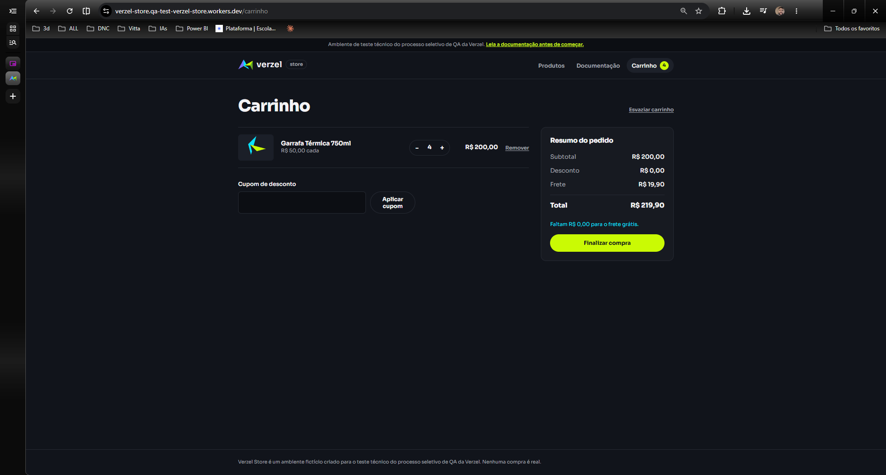
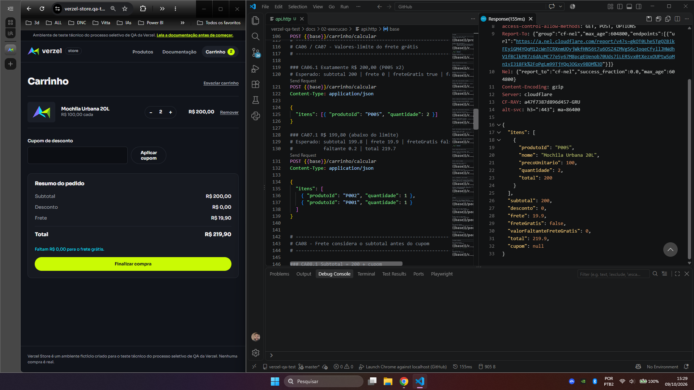

# BUG-001: Frete de R$ 19,90 é cobrado quando o subtotal é exatamente R$ 200,00 (interface e API)

| Campo | Valor |
|---|---|
| **ID** | BUG-001 |
| **Card** | VZS-142 (Cupom de desconto e frete grátis), versão 2.3.0 |
| **Status** | Aberto |
| **Ambiente** | https://verzel-store.qa-test-verzel-store.workers.dev (produção do ambiente de teste) |
| **Onde ocorre** | Interface (carrinho) **e** API (`POST /api/carrinho/calcular`) |
| **Severidade** | Alta |
| **Prioridade** | Alta |
| **Critérios violados** | CA06, CA07, CA08 e a tabela "Regras de cálculo" (Frete) |

## Resumo

Quando o subtotal do carrinho é **exatamente R$ 200,00**, o sistema cobra frete de R$ 19,90 em vez de conceder frete grátis. A documentação diz que o frete é grátis "a partir de R$ 200,00, **inclusive**". Na tela, o resumo ainda se contradiz: exibe "Faltam R$ 0,00 para o frete grátis" ao lado de "Frete R$ 19,90".

## Passos para reproduzir

### Pela interface

1. Acessar a loja e abrir **Produtos**.
2. Adicionar **Mochila Urbana 20L** (P005, R$ 100,00) ao carrinho.
3. Abrir o **Carrinho** e aumentar a quantidade para **2** (subtotal R$ 200,00).
4. Observar o **Resumo do pedido**.

Variação (reprodutível com outro produto): **Garrafa Térmica 750ml** (P008, R$ 50,00) com quantidade **4**.

### Pela API

```http
POST /api/carrinho/calcular
Content-Type: application/json

{ "itens": [{ "produtoId": "P005", "quantidade": 2 }] }
```

### Com cupom (API)

```http
POST /api/carrinho/calcular
Content-Type: application/json

{ "itens": [{ "produtoId": "P005", "quantidade": 2 }], "cupom": "BEMVINDO10" }
```

## Comportamento esperado

| Campo | Sem cupom | Com BEMVINDO10 |
|---|---|---|
| Subtotal | R$ 200,00 | R$ 200,00 |
| Desconto | R$ 0,00 | R$ 20,00 |
| Frete | **R$ 0,00 (Grátis)** | **R$ 0,00 (Grátis)** |
| `freteGratis` | `true` | `true` |
| Total | R$ 200,00 | R$ 180,00 |

## Comportamento obtido

| Campo | Sem cupom | Com BEMVINDO10 |
|---|---|---|
| Subtotal | R$ 200,00 | R$ 200,00 |
| Desconto | R$ 0,00 | R$ 20,00 |
| Frete | **R$ 19,90** | **R$ 19,90** |
| `freteGratis` | `false` | `false` |
| `valorFaltanteFreteGratis` | `0` | `0` |
| Total | **R$ 219,90** | **R$ 199,90** |

Na interface (sem cupom), o carrinho exibe **Frete R$ 19,90**, **Total R$ 219,90** e a mensagem **"Faltam R$ 0,00 para o frete grátis."**

## Análise

- **Contradição interna:** `valorFaltanteFreteGratis` vale `0` ("não falta nada"), mas `freteGratis` é `false`.
- **Só o limite exato falha.** Os valores vizinhos se comportam como documentado: R$ 199,80 cobra frete (correto) e R$ 299,50 tem frete grátis (correto).
- **Reproduz com produtos diferentes** (P005 x2 e P008 x4), logo o problema é o valor-limite, não um produto específico.
- **Hipótese (não confirmada):** a comparação usa "maior que" (`>`) em vez de "maior ou igual" (`>=`).

## Impacto

O cliente paga R$ 19,90 a mais exatamente no caso de borda mais crítico da regra de frete grátis. Afeta a interface e a API, com e sem cupom.

## Evidências

**Interface**




**API (respostas brutas)**

- Sem cupom: [`CA06.txt`](../04-evidencias/api-raw/CA06.txt)
- Com cupom: [`CA08.1.txt`](../04-evidencias/api-raw/CA08.1.txt)



**Controles (comportamento correto nos valores vizinhos)**

- R$ 199,80, frete cobrado corretamente: [`CA07.txt`](../04-evidencias/api-raw/CA07.txt)
- R$ 299,50, frete grátis corretamente: [`CA10.1.txt`](../04-evidencias/api-raw/CA10.1.txt)

## Pendente de confirmação

- [ ] Reproduzir com cupom **pela interface** (até aqui, o cenário com cupom foi evidenciado só pela API).
- [ ] Verificar `POST /api/pedidos` com P005 x2 (o pedido confirmado também cobra o frete?).
