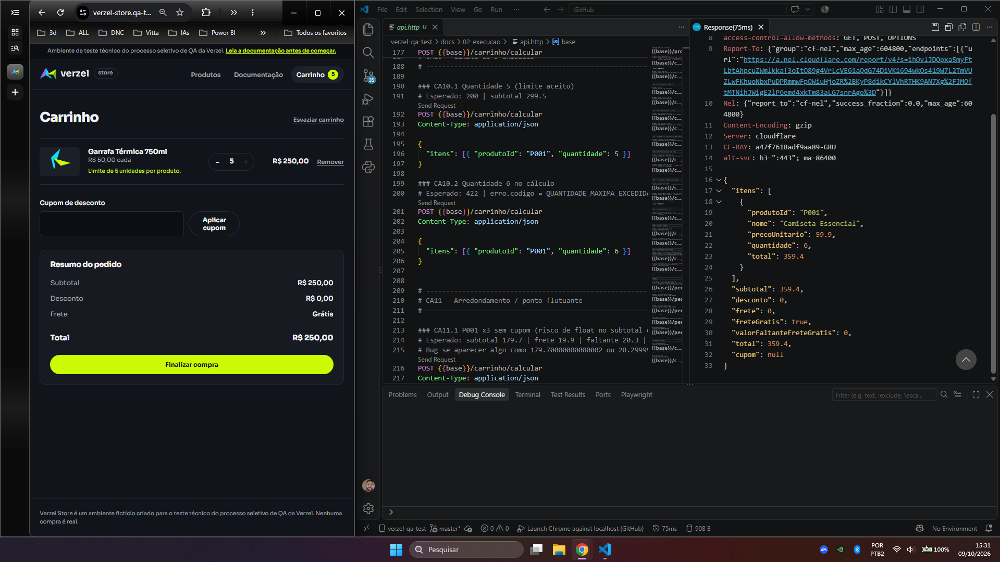
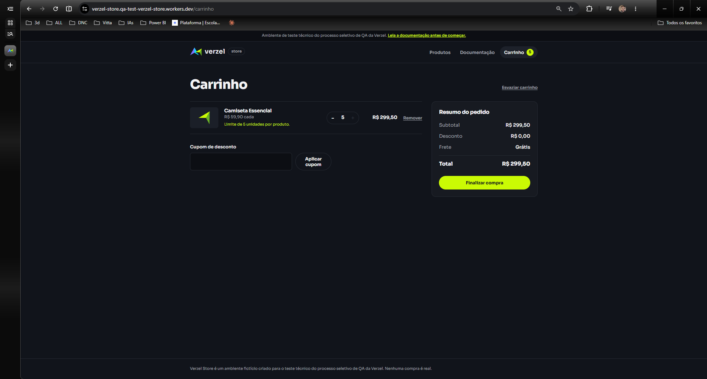

# BUG-002: API aceita mais de 5 unidades por produto (validação do limite só existe na interface)

| Campo | Valor |
|---|---|
| **ID** | BUG-002 |
| **Card** | VZS-142 (Cupom de desconto e frete grátis), versão 2.3.0 |
| **Status** | Aberto |
| **Ambiente** | https://verzel-store.qa-test-verzel-store.workers.dev (produção do ambiente de teste) |
| **Onde ocorre** | **Somente API** (`POST /api/carrinho/calcular`). A interface bloqueia corretamente |
| **Severidade** | Média |
| **Prioridade** | Média |
| **Critério violado** | CA10: "Cada produto pode ter no máximo 5 unidades por pedido. A regra vale para a interface **e para a API**." |
| **Erro documentado** | `422 QUANTIDADE_MAXIMA_EXCEDIDA` ("A quantidade de um produto é maior que 5.") |

## Resumo

A API não valida o limite de 5 unidades por produto. Uma requisição com 6 unidades retorna `200` e calcula o carrinho normalmente, quando deveria retornar `422` com `QUANTIDADE_MAXIMA_EXCEDIDA`. A interface respeita o limite, então a regra existe apenas no front-end e pode ser contornada chamando a API diretamente.

## Passos para reproduzir

```http
POST /api/carrinho/calcular
Content-Type: application/json

{ "itens": [{ "produtoId": "P001", "quantidade": 6 }] }
```

## Comportamento esperado

- Status `422`
- `erro.codigo` = `QUANTIDADE_MAXIMA_EXCEDIDA`
- Nenhum cálculo de carrinho retornado

## Comportamento obtido

- Status **`200 OK`**
- `itens[0].quantidade` = `6`, `total` = `359.4`
- `subtotal` = `359.4`, `frete` = `0`, `freteGratis` = `true`, `total` = `359.4`

## Análise

- **Limite superior aceito corretamente:** com 5 unidades (P001 x5) a API responde `200` como esperado, então só a validação do 6º item e seguintes está ausente.
- **Contraste com a interface:** o carrinho exibe "Limite de 5 unidades por produto." e impede passar de 5. O comportamento diverge entre as duas camadas.
- **Causa provável:** a validação foi implementada somente no front-end (hipótese, não confirmada).

## Impacto

Quem usa a API diretamente (integração, script, outro cliente) consegue montar carrinhos fora da regra de negócio. Um usuário comum, pela interface, não é afetado. A severidade pode subir para **Alta** se o `POST /api/pedidos` também confirmar pedidos com mais de 5 unidades.

## Evidências

**API (resposta bruta)**

- Falha (6 unidades): [`CA10.2.txt`](../04-evidencias/api-raw/CA10.2.txt)
- Controle (5 unidades, aceito corretamente): [`CA10.1.txt`](../04-evidencias/api-raw/CA10.1.txt)



**Interface (comportamento correto, para contraste)**

O mesmo print acima mostra, na metade esquerda, o carrinho travado em 5 unidades: aviso "Limite de 5 unidades por produto." e botão `+` desabilitado. Print complementar com 5 unidades e subtotal de R$ 299,50:



## Pendente de confirmação

- [ ] Testar `POST /api/pedidos` com P001 x6. Se retornar `201`, a regra é violada na confirmação do pedido e a severidade sobe.
